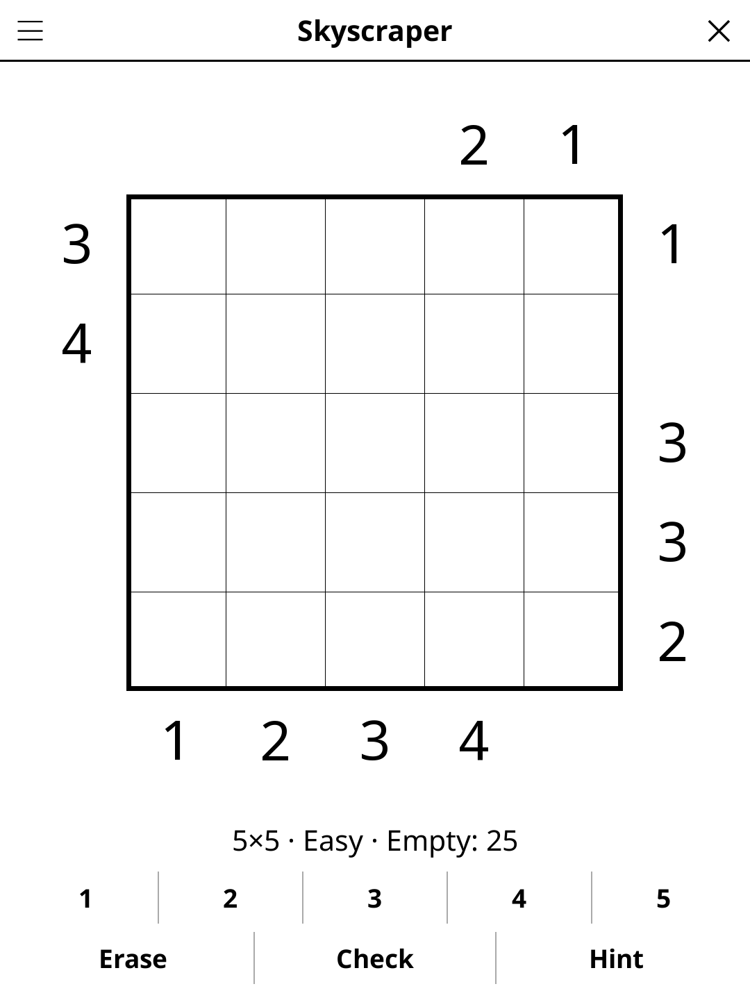

# skyscraper.koplugin

A Skyscraper puzzle plugin for [KOReader](https://github.com/koreader/koreader).

## Screenshot

## Rules

Place building heights 1–N in each row and column (no repeats, like Sudoku). Edge clues show how many buildings are visible from that direction — taller buildings hide shorter ones behind them.

## Features

- **Two grid sizes** — 4×4 and 5×5
- **Three difficulty levels** — every puzzle can be solved by logic alone, with no guessing. Easy shows more clues and needs only the simple steps (what a 1 or an N clue means, how high a cell near a clue can be, the one place left for a height, a row with two empty cells); Medium and Hard also need to work through the orderings a row or column allows with its clue, Hard with the fewest clues
- **Check** — marks the heights that are wrong
- **Hint** — two taps: the first says which cell is about to give, the second acts on it. A cell that contradicts the solution is always reported before a fresh one is revealed
- **Auto-save** — puzzle state saved and restored on next launch

## Installation

1. Download `skyscraper.koplugin.zip` from the [latest release](../../releases/latest).
2. Extract into the `plugins/` folder of your KOReader data directory.
3. Restart KOReader.
4. Open the menu → **Tools** → **Skyscraper**.

## Controls

| Action | How |
|--------|-----|
| Select a cell | Tap it |
| Enter a height | Tap the digit button |
| Erase a cell | Tap **Erase** |
| Check progress | Tap **Check** |
| New puzzle | Tap **New game** |
| Show rules | Tap **Rules** |

## License

GPL-3.0 — see [LICENSE](LICENSE).
